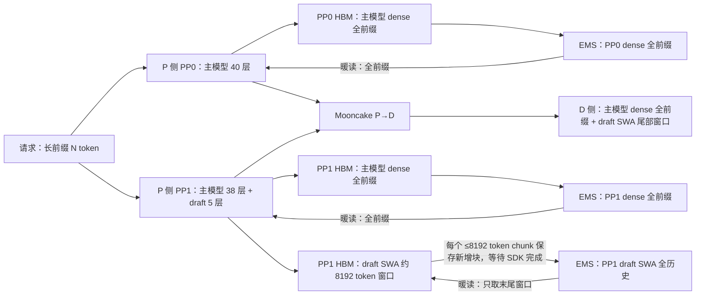

# GLM-5.3 dSpark：HBM 窗口 KV 与 EMS 全量历史 KV

状态：2026-11-14 的运行方案和测量记录。本文描述 31.20 上的 **2P1D NEW1113** 实例，并把另一种“draft KV 全前缀常驻 HBM”的布局作为容量对照。对照布局只做静态计算，**没有在相同条件下部署并测量吞吐**。图中与表中的推算、实测分别标注。本分支保存设计文档、画图数据及当前镜像补丁副本；它不把这些镜像补丁直接应用到本仓库的 vLLM 源码。

## 1. 一页图示

`N=262144`、EMS 块 64 token 时，远端可保存 4096 个 draft SWA 块；同一前缀在 P 侧 EMS 暖读只需末尾约 128 个 SWA 块。Mooncake 的 P→D 窗口裁剪另保守带 1 个边界块。PP0 没有 draft 层。`2P` 表示两套 P 副本，每套 PP2（每个 PP rank 1 GPU）；`1D` 为一套 4-GPU、DP4 的 D 副本。

## 2. 当前配置与实现位置

| 项目 | 当前值 | 作用 |
|---|---|---|
| 基础镜像 | `master_bnt3_glm_dspark1113.20261113144951.BNT3.x86_64` | 不是后来的 `1113_pkv` 镜像 |
| 模型 | `GLM-5.3-W4A4C8-EMS-dspark-mla-2P1D-NEW1113-EMS02` | 31.20 上状态 `ACTIVE`（2026-11-14 核对） |
| P | 2 副本，各 PP2 `40,38`、TP1；MNB 32768、max_num_seqs 8 | 每请求 SWA chunk 限制 8192，批次总预算不变 |
| D | 1 副本，DP4；MNB 1024、max_num_seqs 128 | 推测解码长度 7 |
| 上下文 | max_model_len 1048576 | 主模型及 draft KV 均为 FP8；draft FlashMLA packed 宽度 656 byte/token/layer |
| draft | `mla_5swa_8192/sft-step1200` | 5 个 SWA8192 层，仅在 PP1 |
| EMS | `ems02-02`，约 2 TiB mempool；数据 namespace `cc_kvstore@_@ds_default_ns_001` | 数据 namespace 配额后来调为 2 TiB；淘汰触发/目标 98%/95% |

原始镜像的 `vllm_xds_patch/.../glm_dspark_mla.py::get_kv_cache_spec()` 返回 `SlidingWindowMLASpec(sliding_window=8192)`；原始 `DSparkEmsCache` 已有 dense/SWA 分流的设计，但无法保证长请求的全部 SWA 页写入且可查询。下述 `.patch` 的应用基准是原始镜像的 `/usr/local/lib/python3.12/dist-packages`，并非本仓库根目录。当前运行的补丁由以下三个文件组成：

1. [`patches/pp0_local_kv_allocation_utils.py`](./patches/pp0_local_kv_allocation_utils.py)：作为镜像内 `vllm/v1/worker/utils.py` 的覆盖文件。全局 KV tensor 清单含 PP1 的 draft 层，但 PP0 的本地 group 不含；按本 rank 层名过滤 tensor 与 view，修复 PP0 的 `StopIteration`。运行日志确认 PP0 只有主模型层 0–39，PP1 有主模型层 40–77 和 draft 层 78–82。
2. [`patches/new1113_full_draft_ems.patch`](./patches/new1113_full_draft_ems.patch) 中的 `scheduler.py` 改动：仅在 EMS+dSpark 的 P producer 生效，把每请求新 token 与 in-flight token 限为 8192；`max_num_batched_tokens=32768` 仍允许不同请求合批。原因是一个超过窗口的单步可能在 EMS 读取前回收早期 SWA 页。
3. 同一补丁中的 `dspark_cache.py` 改动：dense 保留 `xds@vllm@...` 键以供 JE 前缀提示；SWA 使用独立的 `xds@dspark_swa@{cache_namespace}@{group_hash}` 分布键。原格式的额外 SWA 属性曾出现 `save.success=1`、`exists.success=0`；独立键跨进程查询成功。保存计划覆盖每个 chunk 的全部新增 SWA 块，暖读计划只查询、加载末尾窗口。缺源页记错误，不把空页当真实 KV。

`ems_adapter.py` 在基础镜像中已对 SWA 保存调用 `_wait_for_dspark_save()`：提交后等待 EMS future ready，才让计算页进入下一步复用。因此当前方案没有 staging 槽，代价是 P 侧每 chunk 等一次 EMS。主模型 dense 仍走原异步保存路径。FlashMLA 算子文件未替换。

## 3. 冷写、暖读和 D 侧加载

**冷写**：P 计算一个最多 8192-token 的 chunk；PP0、PP1 把本轮主模型 dense KV 追加到 EMS，PP1 另外把本轮 draft SWA KV 全部追加到独立流。虽然 PP1 的 HBM 随窗口前移回收旧 SWA 块，EMS 保存过的历史块仍可按前缀 hash 查询。等待本轮 SWA 的 SDK future 完成后，调度器可继续下一 chunk。

**暖读**：先验证 PP0 与 PP1 dense 前缀都存在，再验证候选前缀末尾所需的 SWA 窗口；只有三者同时完整才宣称该前缀命中。PP0/PP1 dense 按命中的完整前缀加载，PP1 SWA 仅加载末尾窗口。EMS SDK 的一个 KV value 不能只加载一部分 buffer，因此 dense/SWA 必须分流，不能把完整 draft 打包进同一个 dense value 后只取尾部。

**P→D**：基础镜像的 Mooncake 对 `SlidingWindowSpec` 传输组在 P 发送、D 接收两边都裁剪为末尾 `ceil(window / KV_block_size)+1` 个块；主模型 dense 不裁剪。D 侧同样按 SWA 窗口管理 draft KV。这里的 `+1` 是保守边界块，和 EMS 暖读 128 个对齐块的实例不同。

## 4. KV 字节节省：最容易画出的数据

按当前 FP8 packed draft 的 5 层 × 656 byte/token/layer，draft 历史为 **3280 byte/token**。HBM 窗口内的 draft 有效载荷上限约 `8192×3280 = 25.625 MiB`；全前缀模式为 `N×3280`。这是**KV 内容字节数**，不是 GPU allocator 已预留的整块物理显存，也不含 hash、页对齐或其他缓存。

| 输入长度 N | 全前缀 draft KV 原始内容 | HBM 窗口 draft KV 原始内容 | HBM 不必常驻的 draft 内容 | draft 内容降幅 |
|---:|---:|---:|---:|---:|
| 32,768 | 102.5 MiB | 25.6 MiB | 76.9 MiB | 75.0% |
| 100,000 | 312.8 MiB | 25.6 MiB | 287.2 MiB | 91.8% |
| 262,144 | 820.0 MiB | 25.6 MiB | 794.4 MiB | 96.9% |
| 1,048,576 | 3.203 GiB | 25.6 MiB | 3.178 GiB | 99.22% |

这些旧 SWA 内容**转移到 EMS**，不是被丢弃。上表的节省主要发生在 P/D HBM；EMS 为了保留全历史会承担相应的 draft 数据量，实际占用还受去重、键/块开销和淘汰影响。例如 100 条完全不同的 262K 冷前缀，仅 draft 原始内容的理论新增量约 80 GiB；实际 EMS 占用不能据此直接推算。

### 为什么有人算出 PP1 增加 14.2%

PP1 有 38 层主模型 MLA attention（每层 576 byte/token）和 9 层 indexer（每层 132 byte/token），合计 `38×576+9×132=23076 byte/token`。五层 draft 则是 `5×656=3280 byte/token`，所以全前缀 draft 相对于 PP1 主模型 KV **原始内容宽度**是 `3280/23076=14.21%`。这个比例本身成立；不能直接等同于整卡 HBM 增加 14.21%。旧镜像采用 SWA 组，后来的 `1113_pkv` 镜像若不开 `VLLM_GLM_DSPARK_MLA_WINDOWED_DRAFT_KV` 或 `VLLM_GLM_DSPARK_MLA_WINDOW_EMS`，则改为全上下文 `MLAAttentionSpec`，这两种布局必须分开讨论。

## 5. 共享 KV block 池的物理占用和并发上限

运行日志中的 `KVCacheTensor` 记录：GPU KV block 为 64 token；PP1 主模型每块 `23076×64=1,476,864 B`，五层 draft 每块 `3280×64=209,920 B`。当前窗口方案的两组 KV tensor 是同一个 GPU backing allocation 的不同 view；全局布局由更宽的 PP0 主模型组决定，物理池 stride 为 `1,575,936 B/block`，池大小 `30,309,977,088 B = 19,233 blocks`。**共享 backing allocation 不表示主模型与 draft 的请求块相同**：两组从同一 block pool 领取不同 block ID。

为画容量图，以下把固定池预算设为上述日志的 `30,309,977,088 B`，假设全前缀 draft 与 PP1 主模型同为 full-attention、合为一组，则其 stride 是 `(23076+3280)×64=1,686,784 B/block`，在同预算下约 17,969 blocks。窗口模式每请求需要 `ceil(N/64)` 个主模型块，再为 draft 预留最多 **129** 个窗口/边界块；全量模式每请求需要 `ceil(N/64)` 个较宽的合并块。这里的并发是 `min(8, floor(池块数/单请求块数))` 的**仅限容量的整数上限**，不是实际 QPS 或实测同时运行数。

| 输入长度 | 全量模式池占用/请求 | 窗口模式池占用/请求 | 窗口节省（正值） | 全量/窗口容量上限 |
|---:|---:|---:|---:|---:|
| 32K | 0.804 GiB | 0.941 GiB | **−0.136 GiB** | 8 / 8 |
| 100K | 2.455 GiB | 2.483 GiB | **−0.028 GiB** | 8 / 8 |
| 144K | 3.535 GiB | 3.492 GiB | 0.043 GiB | **7 / 8** |
| 192K | 4.713 GiB | 4.592 GiB | 0.120 GiB | **5 / 6** |
| 262K | 6.435 GiB | 6.201 GiB | 0.234 GiB | 4 / 4 |
| 295K | 7.239 GiB | 6.953 GiB | 0.286 GiB | **3 / 4** |
| 512K | 12.869 GiB | 12.213 GiB | 0.656 GiB | 2 / 2 |
| 1M | 25.738 GiB | 24.236 GiB | 1.502 GiB | 1 / 1 |

**重要的反直觉点**：原始 draft 内容始终随前缀增长而大幅节省，但共享 block 池中的窗口模式多了一组 block ID。按当前全局 stride 和固定池预算，短于约 **117K token** 时，窗口组的额外块可能超过其 stride 优势，物理池占用反而略高；144K、192K、295K 等长度才出现一个整数并发档位的理论提升。262K 和 1M 的容量上限整数不变，但窗口方案留下更多池余量。长序列高并发还受调度、P 两副本负载、D DP4、EMS 读写及前缀缓存驻留影响；本项目**没有同硬件、同镜像、同流量的 full-draft 对照压测**，所以不能把上述上限当作已实测的并发提升。画图可直接读取 [`data/capacity_model.csv`](./data/capacity_model.csv)；CSV 中 `window_minus_full_pool_GiB` 正值表示窗口模式更耗池。

## 6. 已实测的功能与性能

这些数据均来自当前“旧 `1113` 镜像 + 三处挂载补丁”，**没有测量 full-draft 模式**：

| 测试 | 结果 | 说明 |
|---|---|---|
| 27,021-token 冷写 | HTTP 200；TTFT 10.212 s | PP0 dense 422/422、PP1 dense+SWA 844/844 写入 |
| 清 GPU 前缀缓存、保留 EMS 后暖读 | HTTP 200；命中 27,008 token；TTFT 1.080 s | PP0 从 EMS 加载 422/422，PP1 550/550（422 dense + 128 SWA） |
| 1180 条 262K 级捕获回放 | 1180/1180 HTTP 200；8 个在途、目标 1.2 QPS | 后 1080 条缓存占比 69.62%，TTFT P50/P95/P99=7.69/22.96/36.89 s；每条只生成 1 token |
| 同数据、2TiB 数据 namespace、淘汰阈值 98%/95% | 1180/1180 HTTP 200 | 后 1080 条缓存占比 71.15%，TTFT P50 7.605 s；缓存初态和池配置与上轮不同 |
| 27K 输入、512 输出 token ×3 | 全部 HTTP 200；TPOT 中位数 7.22 ms/token | 单请求测量，不能当作 1180 条回放的 TPOT |

1180 条第一轮中抽查一条真实远端命中：PP0 加载 1193/1193，PP1 加载 1321/1321（1193 dense + 128 SWA）。P 侧时段内 2056 次 `async_load`、9902 次 `async_save` 完成，未见部分成功或失败结束。上述观测证明功能链路、远端命中和该并发条件下的稳定性；**不能证明 full-draft 基线相比的 TTFT、QPS 或实际并发增益**。2TiB 池在这批流量下接近满载，后段命中还受淘汰影响。

详细数值见 [`data/observed_benchmarks.csv`](./data/observed_benchmarks.csv)。完整原始记录保存在 31.20 工作区的 `profiles/new1113_ems02_1180_stress_20261113.md` 和 `profiles/new1113_2p1d_accuracy_cache_report_20261114.md`；本分支只保留画图所需的摘要和补丁，不提交 1.1 GB 捕获数据库与逐条请求内容。

## 7. 作图建议与限制

建议用两张主图避免混淆口径：

1. **KV 数据去向**：横轴前缀长度，画“full draft 原始内容字节”和“HBM 窗口原始内容字节”；将差额标为移至 EMS 的历史 KV。再画冷写/暖读箭头，标注 dense 全前缀、SWA 窗口加载。
2. **容量与并发**：画固定池预算下的 full/window 物理 block 池占用及整数并发档位。必须保留 32K、100K 的负节省和 262K、1M 的同档位结果；不能把 99% 的原始 draft 内容节省误标为 99% 的整卡 HBM 节省。

精度方面，当前实际 checkpoint 是 step1200；已有 GPQA 等快测，但未完成同协议的 full-draft 精度 A/B。1M 单请求与更高并发还未完成本补丁的运行验证。若要发布**实测并发提升**，需在相同镜像、模型、池容量、缓存初态和 2P1D 参数下，仅切换 draft 全量/窗口策略，分别记录 PP1 block 使用、请求排队、TTFT、TPOT 与失败率。
